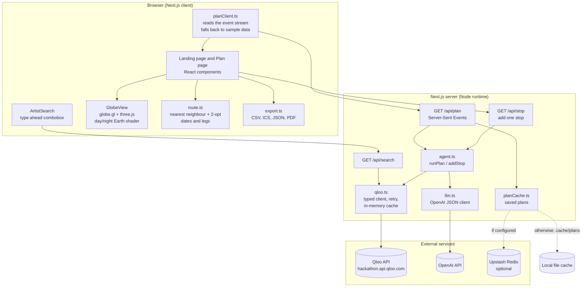
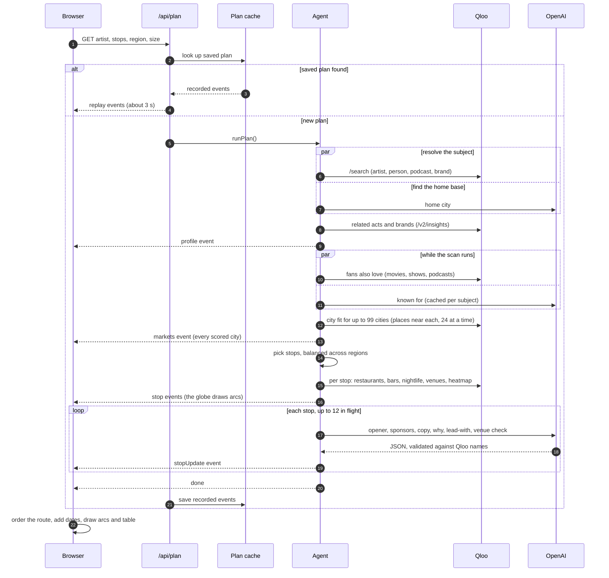

# Headliner

**An AI tour planning agent powered by Qloo's taste data. Type an artist, comedian, sports club or podcast, and a realistic 3D Earth lights up with a worldwide tour: where the fans are, which venues fit, who should open, who should sponsor, and the route between them.**

Built for the [Qloo Agentic Hackathon](https://qloo.devpost.com/?ref_feature=challenge&ref_medium=your-open-hackathons&ref_content=Submissions+open) ("Agents, but with taste").

| | |
|---|---|
| Live demo | _Add the Vercel URL here after deploying_ |
| Code | This repository (MIT license) |
| Taste data | [Qloo API](https://docs.qloo.com/reference/qloo-llm-hackathon-developer-guide) (hackathon environment) |
| AI model | OpenAI API, model set by `OPENAI_MODEL` (the "luna" model) |

---

## Contents

1. [The idea](#1-the-idea)
2. [What it does](#2-what-it-does)
3. [Architecture](#3-architecture)
4. [How Qloo is integrated](#4-how-qloo-is-integrated)
5. [How the AI model is used](#5-how-the-ai-model-is-used)
6. [Route, dates and exports](#6-route-dates-and-exports)
7. [The front end](#7-the-front-end)
8. [API reference](#8-api-reference)
9. [Caching and performance](#9-caching-and-performance)
10. [Project structure](#10-project-structure)
11. [Run it, warm it, deploy it](#11-run-it-warm-it-deploy-it)
12. [Honesty, limits and data handling](#12-honesty-limits-and-data-handling)
13. [How it answers the judging criteria](#13-how-it-answers-the-judging-criteria)
14. [Credits and license](#14-credits-and-license)

---

## 1. The idea

Touring is a multi million dollar bet, and cities are usually picked from past ticket sales and gut feel. Past sales only show where an act already plays. They miss the cities that want a show and have never had one. Openers, venues, sponsors and local marketing are then planned in separate tools by separate people.

A plain language model cannot fix this. It has no live cultural data, so it guesses.

**Headliner uses Qloo's taste graph as the source of truth.** Qloo knows what people in a place love, and how closely an act's fans match them. The agent reads that signal for 99 cities in 7 regions, picks the strongest and most spread out markets, and builds the whole plan from it. A language model is used only to write and to check, never to invent the data.

It works for anything Qloo knows, so the same product covers four worlds:

| Input | Example | "Support slot" becomes |
|---|---|---|
| Musician or band | Coldplay, A. R. Rahman, Bad Bunny | Opener |
| Comedian or actor | Dave Chappelle, Cedric the Entertainer | Opener |
| Sports club | Chelsea F.C., Los Angeles Dodgers | Friendly opponent (a preseason world tour) |
| Podcast | This Week in Startups | Guest show (live recordings) |

---

## 2. What it does

One input gives a full, explainable tour plan.

- **Worldwide scan.** Scores 99 cities across North America, Latin America, Europe, Africa, the Middle East, Asia and Oceania by how well each city's places match the act's fans.
- **Balanced route.** On a worldwide tour every region with data gets stops first, then the rest are filled by score, so the route spans the globe instead of piling up in one continent.
- **Real venues.** Qloo returns stadiums, arenas, concert halls, theatres and clubs near each city, ranked by fan fit. The model then checks which of them actually host concerts.
- **Popularity.** A tier and rank for every city, a popularity by region chart, and global reach from Last.fm.
- **What made them popular.** A "known for" list (songs, albums, specials, seasons, episodes) and a suggested set to lead with in each city. This part comes from the model and is labelled.
- **Best support slot.** Chosen by audience overlap from Qloo, not by genre label.
- **Sponsors.** Brands whose fans look like the act's, each with a short reason tied to the city.
- **VIP and fan plan.** Restaurants, bars and nightlife near each show that the fans rank highly.
- **Route optimizer.** Shortest path, west to east, or highest demand first, with leg distances, travel days, a tour length and dates.
- **Edit the tour.** A dim dot on the globe for every scored city, a "next best markets" list, and Add or Remove buttons that rebuild the route.
- **Any artist worldwide.** Type ahead search over Qloo's catalogue with photos, for acts, comedians, clubs and podcasts.
- **Exports.** PDF brief, CSV, calendar (.ics) and JSON.
- **Never blank.** Saved plans replay in about 3 seconds, and if Qloo is unreachable the app falls back to clearly labelled sample data.

---

## 3. Architecture

### 3.1 System overview



### 3.2 What happens during one plan

The server streams events as the agent works, so the globe draws while the plan is still being built.



### 3.3 Where each decision is made

| Decision | Made by | Why |
|---|---|---|
| Which cities are strong markets | **Qloo** (place affinity near each city) | It is real taste data, not a guess |
| Which stops make the tour | **Code** (score, then regional balance) | Deterministic and explainable |
| Opener, sponsors, venues, restaurants | **Qloo** lists | Every name comes from Qloo |
| Which of those the city suits best | **Model**, limited to Qloo's names | Picks, never invents |
| Ad copy, reasons, set to lead with | **Model** | Writing is what it is good at |
| Which venues host concerts | **Model**, then filtered | Qloo tags are broad (a "stadium" can be a training ground) |
| Route order, dates, distances | **Code** | Pure maths, runs in the browser |

---

## 4. How Qloo is integrated

Qloo is the data backbone. All calls are `GET` requests to the hackathon base URL `https://hackathon.api.qloo.com` with the `X-Api-Key` header, made only from the server (`src/lib/qloo.ts`). The key never reaches the browser.

### 4.1 Endpoints and parameters used

| Feature | Endpoint | Key parameters | What we take from it |
|---|---|---|---|
| Find the subject | `GET /search` | `query`, `types` = artist, person, podcast or brand, `take` | Entity ID, name, tags, description, image, Last.fm listeners and plays |
| Type ahead | `GET /search` | same, four types in parallel | Names and photos, ranked by name match then popularity |
| Opener, friendly opponent, guest show | `GET /v2/insights` | `filter.type` = the subject's own type, `signal.interests.entities` = subject ID, `take` | Related entities with an affinity score (the overlap %) |
| Sponsors | `GET /v2/insights` | `filter.type=urn:entity:brand`, `signal.interests.entities` | Brands whose fans match |
| Fans also love | `GET /v2/insights` | `filter.type` = movie, tv_show, podcast | Taste neighbours |
| City demand | `GET /v2/insights` | `filter.type=urn:entity:place`, `filter.location=POINT(lng lat)`, `filter.location.radius=15000`, `take=10`, `signal.interests.entities` | Affinity of the top places near the city |
| Restaurants, bars, nightlife | `GET /v2/insights` | as above plus `filter.tags` = `urn:tag:genre:place:restaurant`, `urn:tag:category:place:bar`, `urn:tag:category:place:night_club` | VIP and fan picks |
| Venues | `GET /v2/insights` | place type, `filter.tags` = a venue category tag, radius 25 km | Venue names, fan fit, popularity |
| Heat layer | `GET /v2/insights` | `filter.type=urn:heatmap`, location and radius | Affinity cells drawn on the globe |

Venue tags, by chosen show size:

| Size | Qloo tags | Typical capacity shown |
|---|---|---|
| Arena | `category:place:stadium`, `category:place:arena` | 20,000+ and 8,000 to 20,000 |
| Theatre | `category:place:concert_hall`, `category:place:performing_arts_theater` | 1,500 to 4,000 and 800 to 3,000 |
| Club | `category:place:live_music_venue`, `category:place:night_club` | 200 to 1,500 and 300 to 2,000 |

Qloo does not return capacities, so the size shown is the **typical range for the category**, and the interface says so.

The tag IDs were found with `GET /v2/tags` (the guide says there is no static list). We follow the guide's rules: `/v2/insights` is a `GET`, tags must be real tag IDs, and `/recs` and `/recommendations` are never used.

### 4.2 How a city gets its demand score

For each candidate city the agent asks Qloo for the 10 places nearest the city centre that the act's fans rank highest, and takes their **mean affinity**. A city whose places the fans love gets a high mean. Cities where Qloo returns nothing are dropped rather than guessed.

The means are then scaled across all scored cities to a 50 to 99 score:

```
demand = round(50 + 49 * (mean - lowest) / (highest - lowest))
```

The score is a **ranking of taste match**, not a count of fans or tickets. It is shown with the city's rank, for example "Ranks 4 of 93 cities", and a tier (Core, Strong, Growing or Emerging market).

### 4.3 How the tour is chosen from the scores

On a worldwide tour (`pickBalanced` in `src/lib/agent.ts`):

1. Group the scored cities by region and sort the regions by their best city.
2. Take the best city of each region, repeating for `floor(stops / regions)` rounds, so every region with data is on the route.
3. Fill the remaining stops by score, with a cap per region of `max(rounds + 1, ceil(30% of stops))`.

A single region filter (for example Asia) skips the balance and simply takes the best cities in that region.

### 4.4 Subjects that are not musicians

`findSubject` searches artists, people, podcasts and brands in parallel and keeps the best match. An exact name wins, then popularity, with acts preferred on a tie. Sports clubs are often filed as artists in Qloo, so the description is also read to tell a club from a band. The result sets the plan's `kind`, which changes the wording (opener, friendly opponent, guest show, co-headline partner) and the default show size.

### 4.5 Qloo's rules, and how we follow them

- Hackathon key with the hackathon base URL only.
- `X-Api-Key` header, `GET` only, documented parameters only.
- Private server side caching is allowed. Saved plans live in Upstash Redis or in `.cache/plans`, both outside the repository. **Qloo data is never committed.**

---

## 5. How the AI model is used

The model (OpenAI chat completions in JSON mode, `src/lib/llm.ts`) does the work that needs language. It is told to use only names that appear in its input, and its output is checked against Qloo's lists.

| Call | When | Input | Output | Check |
|---|---|---|---|---|
| Home base | once per plan, in parallel with the Qloo lookup | the name | city and coordinates | falls back to a default if invalid |
| Known for | once per subject, cached in memory | name, Qloo description, tags | up to 6 works with year and a short note | titles only, labelled as AI written |
| Per city | one small call per stop, up to 12 at a time | Qloo openers, brands, local places, venues, the known for titles | opener, 3 sponsors with reasons, ad line, "why this city", titles to lead with, concert check per venue | opener and sponsor names must exist in Qloo's lists, lead with titles must be in the known for list, venues the model rejects are removed |

Splitting the work into one small call per city, rather than one large call, lets each stop fill in as soon as it is ready and keeps the whole plan inside the time limit.

If a model call fails, the stop keeps its Qloo only data and a plain fallback line. The plan never blocks on the model.

---

## 6. Route, dates and exports

`src/lib/route.ts` holds pure functions that run in the browser, so changing the route mode or the start date is instant and needs no server call.

- **Shortest:** nearest neighbour from the home city, then 2-opt swaps until no swap shortens the path. On a 10 stop worldwide Coldplay test this cut the route from about 54,000 km (arrival order) to about 40,000 km.
- **West to east** and **Demand first** are the other two orderings.
- **Legs and travel days:** under 450 km is a drive with no extra day, under 2,500 km one travel day, under 8,000 km two, and beyond that three.
- **Dates:** one show per stop, starting on the chosen first show date.
- **Exports** (`src/lib/export.ts`): CSV with venues and the set to lead with, an `.ics` calendar with one all day event per show, JSON, and a print stylesheet for the PDF brief.

---

## 7. The front end

- **Framework:** Next.js 14 (App Router) and TypeScript. Plain CSS with design tokens, no UI kit.
- **Landing page:** a full viewport wordmark with a shield shaped video, grouped suggestions, how it works, who it is for, and how Qloo powers each feature.
- **Plan page:** a three column app. The left column holds the inputs and summary, the centre is the globe, and the right column is the route table and stop details.
- **Design system:** based on the North Kingdom reference: near black canvas (`#050311`), white as the only loud colour, one font weight, 8 px cards, 4 px buttons, a 26 px search field and pill tags, hairline dividers, no shadows. Space Grotesk stands in for FKGroteskNeue.
- **The globe** (`src/components/GlobeView.tsx`, `src/lib/earth.ts`): globe.gl on three.js with a custom shader that blends NASA based 8K day and night maps by a sun direction that stays to the left of the camera, so the day and night edge and the city lights are always in view. Clouds drift on a second layer. Phones and weaker GPUs get 4K textures automatically. Route arcs, pulsing rings, a heat layer and dim market dots sit on top.
- **Accessibility:** keyboard operable combobox, tabs and controls, visible focus, `aria` labels and live regions for the agent trace, and reduced motion is respected.

---

## 8. API reference

### `GET /api/plan`

Streams a plan as Server-Sent Events.

| Query | Values | Default |
|---|---|---|
| `artist` | any name Qloo knows | required |
| `stops` | 5, 10, 20 | 10 |
| `region` | `world`, `north-america`, `latin-america`, `europe`, `africa`, `middle-east`, `asia`, `oceania` | `world` |
| `budget` | `auto`, `club`, `theatre`, `arena` | `auto` |
| `fresh` | `1` to skip the saved plan | off |

`auto` picks arena for very popular acts and for sports clubs, and theatre for comedians, podcasts and smaller acts.

Events (`data: <json>`):

| `type` | Payload | Meaning |
|---|---|---|
| `step` | `label` | A line for the agent trace |
| `profile` | `artist`, `home`, `tags`, `kind`, `source`, `cachedAt?` | Who the plan is for |
| `about` | description, image, Last.fm, known for, fans also love | Sent twice: Qloo parts first, then the model's known for list |
| `markets` | every scored city with its demand | Drives the worldwide dots and the next best list |
| `stop` | a stop built from Qloo data | The globe draws it |
| `stopUpdate` | `id`, `patch` | The model's copy, sponsors, lead with and venue check |
| `error` | `message` | The client falls back to sample data |
| `done` | | Plan complete |

### `GET /api/search?q=`

Type ahead results (up to 7) across artists, people, podcasts and brands, ranked by name match then popularity. Brands are kept only when the name starts with the query, because brand search is noisy.

### `GET /api/stop`

Builds one extra stop for the "Add to tour" button: `artist`, `city`, `demand`, `budget`.

---

## 9. Caching and performance

| Layer | What | Where | Lifetime |
|---|---|---|---|
| Qloo responses | Every request, keyed by URL | In memory | 6 hours |
| Finished plans | The recorded event stream per artist and options | Upstash Redis if configured, else `.cache/plans` (`/tmp` on Vercel) | 7 days |

Measured on this build:

| | Time |
|---|---|
| Fresh 10 stop worldwide plan | about 25 to 35 seconds |
| Saved plan replay | about 3 seconds |

The speed comes from running the city scan 24 requests at a time, building stops 20 at a time and keeping up to 12 model calls in flight. The plan route is limited to 60 seconds.

The 11 demo subjects (listed in `src/lib/demo.ts`) are pre-warmed by `scripts/warm.mjs`, so a judge always gets an instant result. Any other name still works live.

---

## 10. Project structure

```
headliner/
  README.md
  LICENSE                        MIT
  .env.example                   keys to fill in (never commit .env.local)
  scripts/
    warm.mjs                     pre-warm the demo subjects
    qloo-*.mjs, openai-smoke.mjs small tests used while building the integration
  public/
    media/web/                   stock loops and posters (Pexels)
    globe/                       Earth textures (Solar System Scope)
  src/
    app/
      page.tsx                   landing page
      plan/page.tsx              planner page
      layout.tsx, globals.css    font and design tokens
      api/
        plan/route.ts            SSE stream, saved plan replay
        search/route.ts          type ahead
        stop/route.ts            add one stop
    components/
      PlanApp.tsx                the planner: state, tables, detail panels
      GlobeView.tsx              globe layers and camera moves
      ArtistSearch.tsx           combobox over Qloo search
      HeroWordmark.tsx, WorkCard.tsx, ReelLink.tsx, VideoDialog.tsx, Nav.tsx, SearchBar.tsx
    lib/
      agent.ts                   the agent: scan, pick, build, enrich
      qloo.ts                    typed Qloo client, retry, cache, venue tags
      llm.ts                     OpenAI JSON client
      cities.ts                  99 candidate cities in 7 regions
      route.ts                   shortest route, legs, dates
      export.ts                  CSV, ICS, JSON
      earth.ts                   day/night Earth shader and clouds
      planCache.ts               saved plans (Upstash or file)
      planClient.ts              event stream reader and sample fallback
      demo.ts                    suggestions and the sample fallback
      types.ts                   shared types
```

---

## 11. Run it, warm it, deploy it

### Run locally

```bash
npm install
cp .env.example .env.local     # then fill in the keys
npm run dev                    # http://localhost:3000
```

### Environment variables

| Variable | Needed | Notes |
|---|---|---|
| `QLOO_API_KEY` | yes | From the hackathon key request form |
| `QLOO_BASE_URL` | yes | `https://hackathon.api.qloo.com` |
| `OPENAI_API_KEY` | yes | Server side only |
| `OPENAI_MODEL` | yes | The model to use, for example the cheap "luna" model |
| `UPSTASH_REDIS_REST_URL`, `UPSTASH_REDIS_REST_TOKEN` | recommended on Vercel | Keeps saved plans across serverless cold starts |

### Check and pre-warm

```bash
npm run build && npm start           # production check
node --env-file=.env.local scripts/qloo-smoke.mjs   # proves the Qloo key works
npm run warm                         # pre-warm the 11 demo subjects (about 5 minutes)
```

### Deploy to Vercel

1. Import the repository in Vercel.
2. Add the environment variables above. Create a free Redis database at [upstash.com](https://upstash.com) for the two Upstash values.
3. Deploy, then run `node scripts/warm.mjs https://your-app.vercel.app` so the demo subjects are saved.

---

## 12. Honesty, limits and data handling

- **Qloo parts are real, model parts are labelled.** The "known for" list is written by the model from its own knowledge and carries a notice. The "lead with" titles are a suggestion, not a fact. The concert check on venues comes from the model, and a venue it is unsure about is marked "Check availability".
- **Popularity is a taste ranking.** It is not streaming numbers or ticket sales. Qloo does not expose per city listener counts.
- **Capacity is a typical range.** Qloo does not return venue capacity, so confirm real capacity and dates with each venue.
- **Coverage varies by city.** Where Qloo has thin place data, a city can score low or return few venues. Cities with no data are dropped, not invented.
- **Sample fallback.** If Qloo is unreachable, the app shows clearly labelled sample data instead of a blank screen.
- **Keys and data.** Keys live only in server environment variables. Saved plans are stored outside the repository. The model is sent Qloo names and the act's name, nothing about users, and the app has no accounts or personal data.

---

## 13. How it answers the judging criteria

| Criteria | Our answer |
|---|---|
| Technological implementation | Many Qloo features used together (search, related entities, brands, places with location and tags, heatmap) in an agent that streams its work, validates the model's output against Qloo's data, and falls back safely. It runs end to end on live data. |
| Design | A complete product, not a proof of concept: a realistic globe, a three column planner, a route optimizer with dates, venues, exports, loading and empty states. |
| Potential impact | Promoters, venues, agents, sports clubs, comedy and podcast producers, and sponsors. The same engine plans a concert tour, a preseason club tour or a live podcast run. |
| Quality of the idea | Qloo is used for demand discovery, venue fit and sponsor matching, not only "recommend me a movie". |

---

## 14. Credits and license

- Taste data: [Qloo](https://qloo.com).
- Earth textures: [Solar System Scope](https://www.solarsystemscope.com/textures/), CC BY 4.0, based on NASA imagery.
- Stock video: [Pexels](https://www.pexels.com/) (free license). The footage does not show the artists named in the demo.
- Design reference: the North Kingdom site style, rebuilt with original code and content.
- 3D globe: [globe.gl](https://globe.gl/) and [three.js](https://threejs.org/).

Released under the [MIT License](LICENSE).
